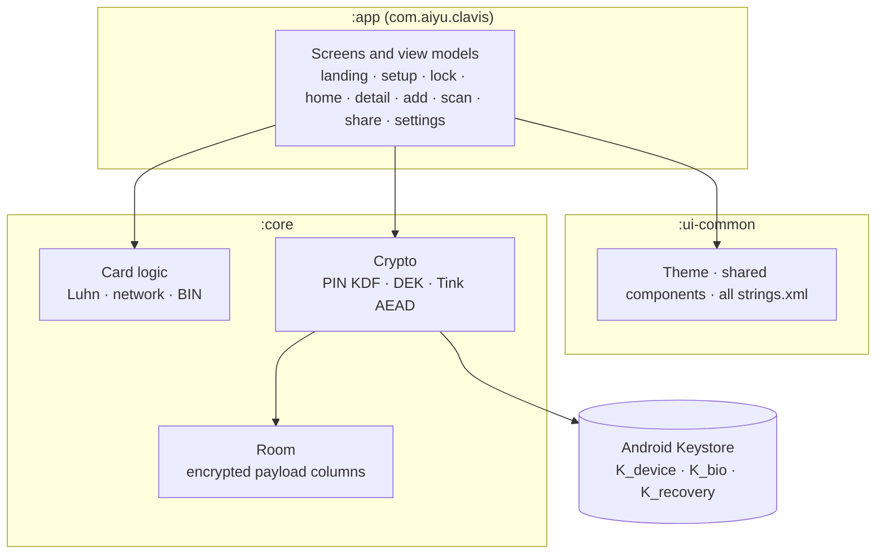

# Clavis


A local card vault for Android. Clavis keeps your cards (number, expiry, holder, optional CVV) behind a
mandatory PIN and optional biometric, with smart copy and a safe share flow. No analytics, no cloud, no account:
your cards never leave the phone. The only network use is the update check against this repository's GitHub releases.

- Mandatory PIN (4–8 digits, trivial PINs rejected) with optional biometric unlock
- Field-level **AES-256-GCM** (Tink); keys wrapped by the hardware-backed Android Keystore
- Scan a card with the camera (on-device text recognition) or type it in; network and issuer detected from the number
- **Smart copy**: copy the number, expiry or holder on its own; every copy is flagged sensitive and clears itself
- **Safe share** as image and text; CVV is off by default and resets every time
- Reveal, copy-CVV and share need a fresh unlock (within 60 s)
- Auto-lock on timeout and screen off; `FLAG_SECURE` hides the app from screenshots and recents
- The only PIN recovery is the phone's own screen lock, or erasing the vault. No email, cloud, hint or security question
- Material 3 Expressive: shared-element transitions, predictive back, animated splash, reduced-motion support
- `allowBackup` is off, so nothing is backed up or transferred
- In-app updates from GitHub releases, installed through Android's own installer (Settings → Updates)

## How it fits together



### Key hierarchy

```
Android Keystore (hardware-backed, non-exportable)
 ├─ K_device    wraps the PIN-path secret
 ├─ K_bio       needs a successful biometric, used through BiometricPrompt.CryptoObject
 └─ K_recovery  needs the phone's screen lock

DEK (256-bit random, generated once at setup, in memory only while unlocked)
 ├─ wrapped by KEK_pin  (PIN -> PBKDF2 -> K_device)
 ├─ wrapped by K_bio    (if biometric is on)
 └─ wrapped by K_recovery (if the phone has a screen lock)
```

Only AEAD ciphertext is stored. The associated data binds each field to its card id, so ciphertext moved
between rows fails to decrypt. The CVV sits in its own column under a separate derived key.

## Documentation

| Need | File |
|------|------|
| Scope and non-goals | [`development/docs/01-PRODUCT.md`](development/docs/01-PRODUCT.md) |
| Threat model, keys, storage, auth | [`development/docs/02-SECURITY.md`](development/docs/02-SECURITY.md) |
| Modules, data model, flows | [`development/docs/03-ARCHITECTURE.md`](development/docs/03-ARCHITECTURE.md) |
| Scan, network and BIN detection | [`development/docs/04-CARD-INTELLIGENCE.md`](development/docs/04-CARD-INTELLIGENCE.md) |
| Copy and share | [`development/docs/05-SHARE-AND-COPY.md`](development/docs/05-SHARE-AND-COPY.md) |
| Theme, screens, accessibility | [`development/docs/06-UX-DESIGN.md`](development/docs/06-UX-DESIGN.md) |
| Decisions and sources | [`development/docs/07-DECISIONS.md`](development/docs/07-DECISIONS.md) |
| Progress | [`development/TODO.md`](development/TODO.md) |

## Requirements

- JDK 17+ and the Android SDK (compile 37, target 36, min 28)
- Point `local.properties` at the SDK: `sdk.dir=/path/to/Android/Sdk`

## Build and run

```bash
./gradlew :app:assembleDevDebug       # dev APK, installs as com.aiyu.clavis.dev ("Clavis Dev", DEV badge)
./gradlew :app:assembleProdRelease    # prod APK, com.aiyu.clavis; the only variant CI releases
./gradlew :core:testDebugUnitTest     # JVM unit tests
./gradlew --offline ...               # when dependencies are already cached
```

Release signing reads `keystore.properties` (gitignored, never commit it).

## Privacy

- The only network traffic is the update check and download from GitHub. A network security config trusts no other host, so no library can send anything elsewhere. No analytics, crash reporting, ads or network SDK.
- Card data never reaches disk, logs or backups in plaintext. Tests use published processor test numbers
  (listed in `development/TempCards.md`), never real cards.
- Every clipboard write sets the sensitive flag and schedules an automatic clear.

## License

Clavis is released under the [MIT License](LICENSE). Third-party libraries keep their own licenses.
